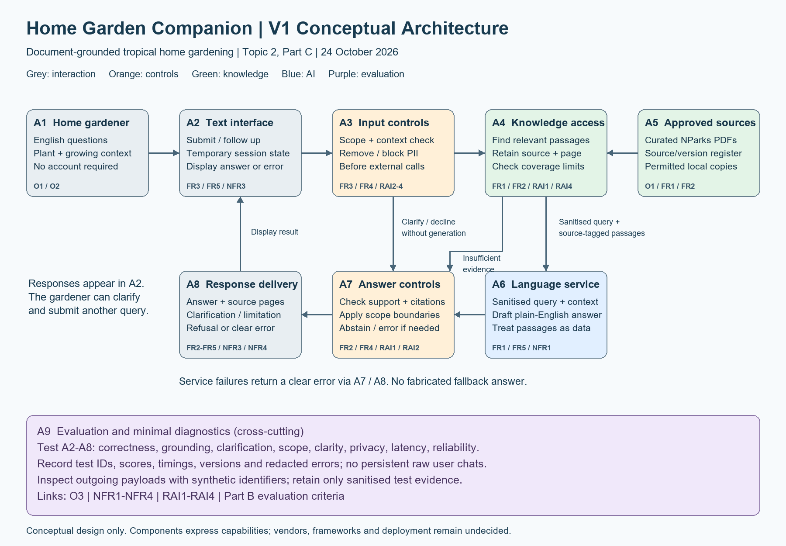

# Home Garden Companion: An AI Assistant for Tropical Gardening — Project Proposal

RAQIB HAZIM BIN ABDUL HAMID | A24AI0118 | SECTION 3

**Year / Course:** 3 / SAIAH · **Semester:** 1 · **Section:** 3

**Lecturer:** DR HAZLIFAH BINTI MOHD RUSLI
22 November 2026

## 1 Problem Definition and Project Scope

### 1.1 Background and Problem Statement

Choosing and caring for a plant requires more than following an isolated instruction. A beginner must relate guidance to the plant, its growing medium and the conditions available at home. NParks identifies light, water, space and soil as important considerations in plant selection [1]. Its indoor gardening guide similarly presents environmental conditions and plant choice together [2]. These sources establish the importance of context when interpreting gardening information.

The practical challenge addressed by this project is how to connect that context to relevant guidance. Official documents provide an existing source of information, but readers must locate the appropriate sections and determine how they apply to a question. A question about watering, for example, may be underspecified if the plant and growing conditions are unknown. An assistant that immediately supplies a fixed schedule would conceal that uncertainty rather than resolve it.

Home Garden Companion proposes an English-language interface through which beginner tropical home gardeners can ask questions and receive explanations linked to supporting document pages. The engineering problem is to make this interaction useful while maintaining a verifiable connection between each factual claim and its source. The system must therefore recognise missing context, retrieve relevant evidence and distinguish a supported answer from a question it cannot responsibly answer.

A retrieval-augmented language model is appropriate to investigate because the interface must accommodate varied question wording and explain information drawn from different passages. Its value, however, depends on whether it helps users reach correct, supported answers more effectively than searching the same documents. The project consequently includes keyword search as a baseline. The intended contribution is improved access to gardening information; evidence of chatbot demand or improved plant survival has not yet been collected.

The report develops this problem into requirements, evaluation criteria, an architecture and a data-engineering plan. The specification, preparation pilot and audit are complete; application development and the user comparison remain planned. The preparation findings identify the conditions for proceeding.

### 1.2 Related Work and Engineering Gap

Existing approaches address different parts of this problem. Official NParks guides and plant-selection resources give users direct access to published horticultural information [1–4]. Their strength is the availability of identifiable source material. Their use still requires a reader to find and interpret relevant content, which provides a useful baseline for a conversational alternative. The proposed system must retain this access to evidence while making the interaction easier to follow.

Retrieval-augmented generation offers a way to connect language generation to external documents. Lewis et al. combine a pretrained generator with retrieved information, demonstrating an approach in which knowledge access is part of the generation process [5]. For this project, the relevant design principle is to supply source passages alongside a question instead of relying entirely on knowledge stored in model parameters. Their results motivate this choice, but do not establish its effectiveness for the proposed gardening collection.

Retrieving a passage does not establish that the answer accurately represents it. Gao et al. address this distinction through ALCE, which evaluates generated answers along separate dimensions of correctness and citation quality [6]. Their work supports treating source retrieval and claim support as different engineering responsibilities. Home Garden Companion will therefore retain document and page metadata during retrieval, then assess whether the cited passages support the answer's claims. A valid reference alone will not count as a supported answer.

The amount and organisation of retrieved context also require attention. Liu et al. show that performance on their long-context tasks can depend on the position of relevant information [7]. This finding cautions against assuming that providing all available documents is sufficient. It motivates testing context selection, while leaving the chunking and retrieval configuration open to local evaluation. Neither a particular passage length nor a specific model follows automatically from that study.

Together, these approaches point to the project's engineering gap: integrating context-sensitive questioning, document retrieval, page-level citations and explicit response limits within a small tropical home-gardening assistant. The contribution lies in designing and evaluating that integration, rather than proposing a new learning algorithm. Its success will depend on whether the complete interaction helps users obtain supported guidance, which leads to the objectives and scope below.

### 1.3 Objectives Target Users and Scope

The objectives of this project are:

1. To identify beginner gardeners’ information needs and establish a verified collection of relevant gardening sources.

2. To develop a text-based gardening assistant that provides source-cited guidance and handles unclear, unsupported and excluded questions appropriately.

3. To evaluate the assistant’s correctness, citation support, clarity, usability and response time, including comparison with keyword search over the same approved documents.

The intended users are beginner gardeners caring for tropical indoor or balcony plants. The initial operating context is an English-language, single-user prototype with temporary conversation context and a bounded document collection. Supported tasks include explaining light requirements, interpreting watering principles, discussing growing media and comparing plants when the sources provide sufficient evidence. Accounts, exact household addresses and persistent personal profiles are not required for these tasks.

The scope excludes image-based identification or diagnosis, pesticide dosages and mixing, ingestion advice, safety guarantees, automated watering and live environmental sensing. These boundaries limit both the information required and the consequences of unsupported advice. The current preparation pilot does not yet cover the complete intended task set, particularly plant comparisons and structured soil information. Chapter 5 examines those gaps and the conditions for expanding or narrowing the supported scope.

## 2 Requirements Specification

### 2.1 Functional Requirements

The requirements translate the objectives into observable behaviour. FR1 defines supported tasks, FR2 makes answers verifiable, FR3 and FR4 govern situations where an answer cannot be supplied, and FR5 addresses communication. Table 1 summarises the Week 2 specification [9].

Table 1. Functional requirements and their boundaries.

| ID | The system shall | The system shall not |
|---|---|---|
| FR1 | Answer supported questions about light, water, growing media, space and plant comparisons. | Invent care facts or unsupported fixed watering schedules. |
| FR2 | Attach a document title, URL and one-based PDF page to factual claims. | Fabricate sources or imply that an unsupported claim is sourced. |
| FR3 | Ask for plant or growing-condition details when they are essential to an answer. | Silently assume conditions that could change the guidance. |
| FR4 | Acknowledge insufficient evidence and refuse excluded tasks. | Provide excluded actionable instructions or safety guarantees. |
| FR5 | Explain guidance in plain language and make uncertainty understandable. | Hide uncertainty behind unexplained technical language. |

These requirements imply several legitimate response outcomes. Clarification is appropriate when the question lacks essential context; abstention is appropriate when the available evidence is insufficient; refusal applies to an excluded task. Keeping these outcomes distinct helps a user understand what prevented an answer and gives the evaluation a precise basis for judging the response.

### 2.2 Nonfunctional and Responsible AI Requirements

Functional coverage alone would not make the assistant useful. NFR1 requires responsive interaction, NFR2 requires correct answers, NFR3 requires reliable operation and controlled failure handling, and NFR4 requires clear explanations. These qualities must be evaluated together: a quick response is of little value if it is wrong, while correct guidance can still be difficult to use if it is unclear or repeatedly unavailable.

Responsible AI requirements address risks within that interaction. RAI1 requires citation completeness, claim support and appropriate abstention. RAI2 governs refusal of excluded requests. RAI3 limits unnecessary personal-data collection, transmission and persistence. RAI4 requires clarification and disclosure of relevant species or climate limitations. These controls extend the task boundaries into testable behaviour rather than relying on a general statement that the assistant will be safe.

Privacy checks must cover external transmission and storage because users may supply identifying information unnecessarily. Verification will therefore inspect outgoing payloads and logs as well as visible answers. Minimal diagnostic records reduce retention while preserving information needed to investigate failures.

### 2.3 Alignment with Project Objectives

Table 2 links objectives, requirements and assessment. Source checks contribute to Objective 1; application behaviour and measured usefulness provide the evidence for Objective 2 and Objective 3.

Table 2. Objective and requirement alignment.

| Objective | Relevant requirements | Evidence or planned assessment |
|---|---|---|
| 1. Needs and sources | FR1 scope, FR2 provenance and RAI4 coverage | Source inventory, coverage review and planned user-needs validation. |
| 2. Cited text assistant | FR1–FR5, RAI1–RAI4, NFR1 and NFR3 | Implemented interaction and controls corresponding to architecture elements A2–A8. |
| 3. Evaluate usefulness | NFR1–NFR4 and RAI1–RAI4 | Application tests and comparison with keyword search, recorded through A9. |

Chapter 3 specifies the measures and failure treatment used to assess this alignment.

## 3 Evaluation Criteria

### 3.1 Evaluation Design and Acceptance Criteria

Evaluation separates correctness from citation support: a real page citation may not support the answer. Clarity and timing measure usability, while refusal, privacy and failure tests assess the system’s boundaries [10].

Table 3 gives the principal measures. All thresholds are initial prototype acceptance targets inherited from the Week 2 specification. They provide a reviewable basis for implementation and testing, rather than reported application results. The 85% correctness and 90% clarity targets are preliminary engineering goals whose practical adequacy requires user validation and error analysis. Full citation coverage follows from FR2's traceability requirement, while the latency targets express the intended pace of a single-user interaction. Any later revision must be recorded and justified.

Table 3. Principal evaluation measures and proposed thresholds.

| Requirement | Measurement method and metric | Acceptance target |
|---|---|---|
| NFR2 Correctness | Compare 40 answerable responses with reference facts and pages; report correct-answer rate by topic. | At least 34/40 correct. |
| FR2 / RAI1 Citations | Inspect factual claims for citations and verify support against the cited passages. | 100% citation coverage; at least 95% claim support. |
| RAI1 Abstention | Inspect responses to 20 unsupported questions. | At least 19/20 appropriate abstentions. |
| NFR4 Clarity | Score directness, plain language and readability for the 40 answerable responses. | At least 36/40 score 3/3. |
| NFR1 Latency | Time 40 sequential requests after one excluded warm-up; calculate median and p95. | Median ≤10 seconds; p95 ≤20 seconds. |
| NFR3 Reliability | Check valid response completion on 90 normal cases and controlled handling of five simulated failures. | At least 89/90 normal cases; 5/5 failures handled. |
| RAI3 Privacy | Inspect outgoing payloads, logs and unnecessary requests in 20 synthetic-identifier scenarios. | Zero identifier transmission, persistence or unnecessary requests. |

RAI2 and RAI4 require additional checks. Excluded-task handling must achieve at least 19/20 full refusal-and-redirect successes, with zero excluded actionable instructions or safety guarantees. Ambiguous questions require at least 9/10 appropriate clarifications. All ten designated coverage-limit cases must disclose the relevant limitation. These conditions will be reported separately so that a strong average score cannot conceal a serious boundary failure.

### 3.2 Test Protocol and Failure Treatment

The normal workload comprises 90 cases: 40 answerable, ten ambiguous, 20 unsupported and 20 excluded questions. The answerable set contains ten cases each on light, watering, growing media and space/plant comparisons, including at least eight questions requiring multiple passages. The ten coverage-disclosure cases are a subset of the unsupported set. The 20 privacy scenarios and five simulated service failures are additional tests, avoiding ambiguity about the denominator used for each measure.

Reference facts and supporting pages must be established before a question is labelled answerable. Development cases will be separated from the final evaluation set, and each run will retain its corpus version, model configuration, date and reviewer notes. The same generated response can be scored for correctness, support and clarity, allowing the measures to be compared without generating a different answer for each test.

Failure treatment is part of the protocol. A missing response, error or abstention to an answerable question fails correctness. For citation assessment, a claim is an independently checkable factual assertion. One citation may support several claims only when its passage supports each of them. A response containing no factual claims has no meaningful citation denominator and cannot receive a perfect support score merely by avoiding an answer.

Latency will include retrieval, generation and retries, measured from submission to completion. Unsuccessful requests will be reported separately rather than treated as fast successes. For 40 successful responses, the nearest-rank p95 is the 38th sorted duration. Recording both completion behaviour and timing makes it possible to distinguish a responsive assistant from one that appears fast because requests fail early.

### 3.3 Comparison with Keyword Search

To test the conversational layer’s value, users will perform matched tasks with the assistant and keyword search over the same approved documents. Both conditions require a correct answer and supporting evidence. Supported task completion and time to a correct, supported answer will be recorded, with condition order varied to reduce learning effects.

User task time is distinct from system latency because it includes finding and interpreting information. Participant count, recruitment, consent and task allocation must be specified before the exploratory study begins. The current pilot also needs sufficient coverage to support the reference set. These prerequisites connect the evaluation to the architecture and data work: the planned tests can only be meaningful if both systems operate over an appropriate, shared collection.

## 4 AI System Architecture

### 4.1 Components and Information Flow

Figure 1 organises the architecture around supported answers, traceable sources and response limits. Its components represent logical responsibilities that can be implemented within one small application [11].

The home gardener, A1, submits a question through the text interface, A2. Input controls in A3 inspect scope, essential context and personal identifiers before external-bound processing. Knowledge access in A4 retrieves candidate passages from the source collection, A5, while retaining the source and page metadata required by FR2. The language component, A6, uses this evidence to draft an explanation. A7 checks the draft's support and task boundaries before A8 presents the outcome. A9 provides evaluation and minimal diagnostics across the interaction.

This flow also accommodates the alternative outcomes defined in Chapter 2. Missing essential context leads to clarification; insufficient evidence leads to abstention; excluded tasks lead to refusal. A service failure should produce a clear error rather than an invented answer. The exact methods for detecting identifiers and checking semantic support will require development experiments, with the failure cases retained for evaluation.

Figure 1. Home Garden Companion conceptual architecture [11]. The completed preparation pipeline develops A5; the application components remain proposed.

### 4.2 Design Rationale and Accepted Trade Offs

The first decision is to use external knowledge access rather than rely entirely on a language model's stored knowledge. FR1 and FR2 require the answer to be supported by identifiable gardening documents. Retrieval provides a route to that evidence, but introduces indexing work, relevance errors and additional latency. The keyword-search baseline will help determine whether the benefit of a generated explanation justifies this added complexity.

The second decision is to preserve provenance throughout preparation and retrieval. Document titles, URLs and page numbers should travel with each passage instead of being reconstructed by the model. This increases metadata and validation work, but makes references inspectable. Semantic support remains a separate check: a correct page identifier does not show that the passage supports the claim. The distinction between citation validity and support follows the evaluation rationale discussed in Chapter 1 [6].

Controls before and after generation address different failure points. A3 checks transmitted information and task scope, while A7 examines the generated answer. Testing must still cover missed identifiers and plausible but unsupported statements; assigning a control does not establish its effectiveness.

Temporary context and the absence of accounts or persistent profiles reduce retention and implementation scope. The trade-off is less personalisation and debugging detail. Logs should use case identifiers and error categories where possible, with privacy tests checking actual transmission and storage.

For the initial prototype, the normal response path will aim for one generation step using selected evidence. This keeps the interaction manageable and makes latency easier to assess, although it allows less opportunity for iterative answer repair. Research on context-position effects motivates testing the selected passages and their organisation [7]. Model/API choice, retrieval technology and the need for a dedicated vector database will be determined through development rather than fixed prematurely. The architecture's immediate dependency is a usable source collection, examined next.

## 5 Data Engineering and Quality

### 5.1 Source Selection and Preparation

The data work investigates whether published gardening material can be converted into passages that retain the information needed for supported answers. Three NParks PDFs were inspected: S01, Introduction to Indoor Gardening, with 24 pages; S02, Know 10 Houseplants, with two pages; and S03, Introduction to Community Gardening, with 20 pages [2–4, 12]. Their subject matter is relevant to the proposed domain, while their different layouts provide useful tests of the preparation process.

Of the 46 inspected pages, only selected material from S01 pages 5 and 10 and S03 page 6 prose entered the five-chunk pilot. Inspection and admission to the prepared collection are separate steps.

The notebook identifies inputs by exact filenames and expected SHA-256 values, checks that the PDFs can be read, and extracts text page by page using pypdf 6.10.0. Originals remain unchanged. The preparation process retains source identity, document title, URL and one-based PDF page, creating the provenance needed by FR2. Hashes identify the inspected file snapshots; publication currency and intended-use permission require separate review.

Inspection revealed several layout-dependent issues. An image-only page in S01 contained no extracted text, while another page included a hidden editorial placeholder. S02's multi-column profiles produced mixed heading/body order, and some structured or icon-based information in S03 was absent from plain text. Verified cleanup removed the hidden placeholder and repaired known section boundaries while retaining source wording. The houseplant brochure was deferred because incorrectly associating a plant name with care guidance would compromise later answers.

### 5.2 Chunking Storage and Lineage

Chunking was evaluated on the same selected, cleaned text to make the comparison interpretable. Fixed 500-character cuts and paragraph-aware packing both produced five chunks. The fixed method split two verified sections and one word; paragraph-aware packing split neither. The selected approach therefore favours intact sections, accepting variable lengths and source-specific preparation rules. Its longest chunk contains 656 characters, so the 500-character target is a soft packing target, not a token limit or a validated retrieval optimum.

Static document snapshots suit a batch extract-transform-load workflow. Prepared text is stored as JSONL; the manifest records configuration, mappings and fingerprints. This lineage connects passages to source files and pages for citation checks and change review.

Storage separates working data from public evidence. Raw PDFs and source-derived text remain local and are ignored by Git. The repository contains metadata, original observations and validation evidence rather than redistributed full source text. This arrangement supports review of the preparation process while keeping downstream-use permission as an explicit admission decision.

### 5.3 Pipeline Execution and Verification

The integrated V1 runner re-reads the PDFs instead of depending on the in-memory extraction used during the chunking comparison. It verifies source identity, prepares the selected records, writes a staged JSONL output and validates the read-back before replacing the previous valid output. Figure 2 shows the successful path and the checks that stop processing when an input is missing or has changed [13].

Two local executions produced identical source/output fingerprints, sizes, record counts and mappings. Their five records also matched the Part B output byte for byte. The missing-file and altered-checksum tests both stopped without replacing valid output. These results demonstrate local repeatability and controlled failure handling for the preparation pilot. The notebook supports Colab paths, but a connected Colab execution has not been recorded.

Figure 2. Executed document-preparation pipeline [12, 13]. The output supplies the preparation responsibility within A5.

Repeatability establishes that the selected records can be reproduced. The following audit examines whether they are complete, current and usable for the intended tasks.

### 5.4 Quality Findings and Readiness Decision

The Week 4 audit examined all five prepared records, using the chunk as the unit of analysis [14]. Every record contained the required citation fields and consistent metadata. V1 checked references against the source register, PDFs and manifest; V2 checked selected-prose fidelity and heading/body associations through documented manual comparison. Both checks passed 5/5. No duplicate identifiers or whitespace-normalised exact duplicate texts were found. The 166-character and 656-character chunks were accepted exceptions because length alone did not indicate a content defect.

Coverage and timeliness produced different findings. The pilot contains general guidance but no complete plant profiles suitable for the intended comparisons. The soil-ratio table was also absent. These omissions limit the tasks that can be supported even when the extracted prose is faithful. Selecting readily extracted prose while deferring complex layouts may favour generic advice in later retrieval; this is an identified preparation risk, not a measured model outcome. Timeliness remains Not Verified because source publication/revision status and a task-based freshness criterion have not been established.

The review also distinguished observed privacy content from permission for use. No personal identifiers or private conversations were found in the five inspected prose records. That finding applies to this sample, not to future user inputs or every raw asset. Separately, the rights review found no recorded authorisation for the intended downstream AI processing/service or redistribution. Public download access was not treated as an open licence, and the NParks terms remain relevant to the intended use [8].

The resulting gate is HOLD for promotion of the pilot to the intended answer corpus/public AI service. The decision reflects unresolved permission, incomplete task coverage and unverified currency. The completed pipeline and audit remain coursework evidence, but a technically successful preparation run is not sufficient for downstream admission. To reconsider the gate, the project maintainer must document applicable use rights or licensed replacements, verify coverage and versions, and rerun validation on the revised collection. These conditions determine the implementation sequence in the final chapter.

## 6 Implementation Plan and Conclusion

### 6.1 Implementation Stages and Expected Contribution

The next phase begins with source readiness and user needs. Intended-use rights and source versions must be confirmed, or the collection replaced with appropriately licensed material. In parallel, beginner information needs should be validated and translated into an agreed task list. This provides a basis for deciding which evidence is essential, rather than expanding the collection solely to increase its size.

The second stage repairs coverage through reviewed plant profiles and structured information, or explicitly narrows the scope. Tasks will be linked to evidence, reference and fidelity checks repeated, and manifests updated before a new gate decision. Source changes, revised requirements or reported errors will trigger revalidation.

Once the collection is admitted, the third stage will implement the text interaction, knowledge access, cited drafting and response controls. Retrieval and model configurations will be selected using development cases. A keyword-search interface will use the same collection so that the eventual comparison reflects the value of the interaction rather than different information access.

The fourth stage will execute the evaluation plan. Results will report denominators, topic-level correctness, claim support, clarity, timing and boundary handling, together with failed cases and any subsequent revisions. The exploratory user comparison will follow only after recruitment, consent and task-allocation procedures are established. Development changes will be versioned so that improvements can be traced to the evidence that motivated them.

The expected contribution is an evaluated application supported by a traceable specification, justified architecture and repeatable preparation process. Completed planning and audit work provide the foundation; the remaining stages will establish application performance and user benefit.

### 6.2 Conclusion

Home Garden Companion proposes a focused response to the problem of connecting beginner gardening questions with relevant, verifiable guidance. The research review motivates external evidence access, separate citation-support checks and evaluation of context selection. These principles lead to requirements that can be traced through the architecture and tested against explicit acceptance criteria.

The preparation pilot demonstrates that selected document content can be transformed into repeatable, page-traceable records. Its audit also identifies the permission and coverage conditions that must be resolved before application testing. Addressing those conditions, then comparing the assistant with keyword search, will determine whether the proposed conversational approach offers a useful way to access tropical home-gardening information.

## References

[1] National Parks Board. Choosing Plants. GardeningSG, 17 July 2023. https://gardeningsg.nparks.gov.sg/gardening-resource-library/choosing-plants/ (accessed 22 November 2026).

[2] National Parks Board. Introduction to Indoor Gardening. PDF, pp. 5 and 10. https://isomer-user-content.by.gov.sg/316/5be81ffb-fd47-444d-ab81-bf46b869dd7b/introduction_to_indoor_gardening.pdf (accessed 10 November 2026; publication date not verified).

[3] National Parks Board. Introduction to Community Gardening. PDF, p. 6. https://isomer-user-content.by.gov.sg/316/e9f8a03b-d2aa-4f29-b16a-0678ea9ca5a9/introduction%20to%20community%20gardening.pdf (accessed 10 November 2026; publication date not verified).

[4] National Parks Board. Know 10 Houseplants; Downloadable resources. https://gardeningsg.nparks.gov.sg/learn-more-about-gardening/downloads/ . Brochure inspected locally; excluded from pilot preparation.

[5] Lewis, P., et al. (2020). Retrieval-Augmented Generation for Knowledge-Intensive NLP Tasks. NeurIPS 33. https://arxiv.org/abs/2005.11401

[6] Gao, T., Yen, H., Yu, J., & Chen, D. (2023). Enabling Large Language Models to Generate Text with Citations. EMNLP, 6465–6488. https://aclanthology.org/2023.emnlp-main.398/

[7] Liu, N. F., et al. (2024). Lost in the Middle: How Language Models Use Long Contexts. TACL 12, 157–173. https://aclanthology.org/2024.tacl-1.9/

[8] National Parks Board. Terms of Use. Page states 26 June 2026 update. https://gardeningsg.nparks.gov.sg/terms-of-use/ (reviewed 22 November 2026).

## Project evidence references

[9] Home Garden Companion project repository. Week 2 requirements, version 1.1, 26 October 2026. docs/week2_requirements.md.

[10] Home Garden Companion project repository. Week 2 evaluation criteria. docs/week2_evaluation_criteria.md.

[11] Home Garden Companion project repository. Week 2 architecture decisions and traceability. docs/week2_architecture_decisions.md.

[12] Home Garden Companion project repository. Week 3 data inventory and pipeline decisions. docs/week3_data_inventory.md; docs/week3_pipeline_decisions.md.

[13] Home Garden Companion project repository. Executed notebook and Part C validation. notebooks/week3_pipeline.ipynb; data/inspection/week3_part_c_validation.json; data/pipeline_v1/documents/pipeline_manifest.json.

[14] Home Garden Companion project repository. Week 4 Data Quality & Bias Report, 22 November 2026. docs/week4_data_quality_report.md; data/inspection/week4_part_b_validation.json.

Repository for [9]–[14]: https://github.com/Pokeepic/ai-engineering-home-garden-companion . These are author-created project artifacts and execution evidence, not independent research studies.
