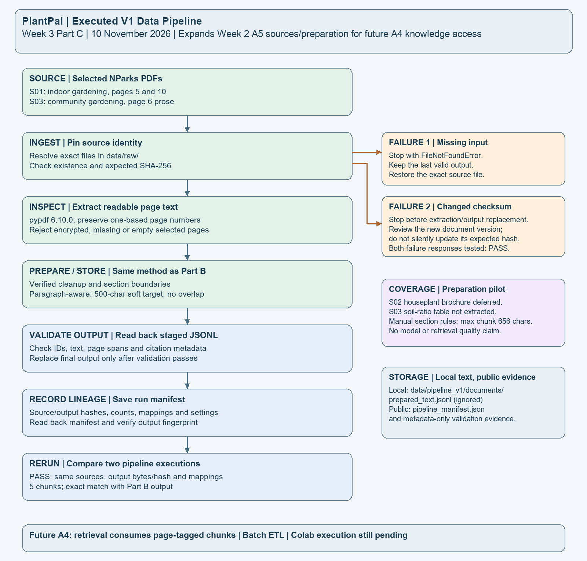

# Home Garden Companion: An AI Assistant for Tropical Gardening — Project Proposal

RAQIB HAZIM BIN ABDUL HAMID | A24AI0118 | SECTION 3

**Year / Course:** 3 / SAIAH · **Semester:** 1 · **Section:** 3

**Lecturer:** DR HAZLIFAH BINTI MOHD RUSLI
22 November 2026

## 1 Problem Definition and Project Scope

### 1.1 Background and Problem Statement

A single question such as "How often should I water my plant?" does not provide enough information to answer the question completely, since what constitutes "appropriate" depends on the specific plant species and the growth conditions. NParks recommends four main factors when choosing plants: Light, Water, Space, and Soil. NParks has also produced a guide for Indoor Gardening to help match environmental conditions with the specific plant that would thrive in those environmental conditions. These recommendations represent why it is important for any gardening advice to have context when evaluating the usefulness of a recommendation.

While published guides provide valuable knowledge for all kinds of gardeners, simply reading and interpreting what is published does not allow a user to make an effective choice based on that publication unless the information is presented in a way that identifies the conditions that will be encountered when the advice is used and the ideal conditions for the chosen plant. In addition, when a novice gardener is looking for an answer regarding how often to water their plant, they may not have sufficient information at the time of the question. Therefore, providing an answer based on a predetermined schedule would be based on an assumption of what conditions exist rather than on factual information.

Home Garden Companion will provide beginning tropical indoor and balcony gardeners with the ability to search for and retrieve appropriate gardening passages from published gardening documents, as well as the necessary vocabulary to help interpret that gardening passage in a manner that will enable them to determine the guidance provided in the flat language presented in the Home Garden Companion and to identify what document contains the passage. In cases where the guidance cannot be provided by specific legal references, the guidance will provide a reason for the lack of supporting evidence. This design has incorporated the recognition that recognising the limits of any guidance constitutes part of providing guidance that has value.

The proposed language model is being explored because novices express the same question in different words, and they may require an explanation of how to implement the information from multiple published gardening documents. At this time, whether this approach will improve the potential access to relevant information regarding gardening remains to be determined through empirical testing. Therefore, a comparison of the Home Garden Companion with keyword searches in the same source documentation will be conducted. No user tests have yet verified whether there is a need for the Home Garden Companion nor whether the Home Garden Companion would improve gardening results compared to the published source documentation.

The fundamental question being evaluated is the effect that a conversational interface will have on helping novice gardeners obtain the right information from published documentation and to obtain the correct information from published documentation through the means of a Home Garden Companion rather than by directly searching published documentation. The test to provide an answer to this question requires that all published gardening literature be available to all novice and experienced gardeners. The basis of this work is established through determining the literature and the means of assessing the user's ability to successfully execute the tasks associated with implementing the guidance provided by the Home Garden Companion and to obtain the correct information as presented in published gardening literature. Therefore, the application and testing of both the Home Garden Companion and the source of published gardening literature will be developed and conducted.

### 1.2 Related Work and Engineering Gap

As mentioned earlier, the initial phase behind providing users with this service involves providing users with direct access to NParks’s official guides, ultimately allowing users to view identifiable horticultural materials independently [1–4]. By providing users with a conversational-driven interface, users will benefit by adding an interpretation layer and will now understand their access to the resources better. To justify the additional layer of complexity added, the information found should also provide readers with the ability to use the resources to verify evidence, not just allow them to search for source material. Research on the retrieval and generation of information helps determine the technological parameters that must be established to support the claim of the benefits gained.

As proposed by Lewis et al., they combined a generator model with external determinants of knowledge via retrieval, thus making access to outside knowledge part of their answer generation process (retrieval-augmented generation) [5]. This provides a way of addressing the gardening-related posts people may have by providing users with a way to retrieve information to generate articles based on their questions. Their model provided evidence supporting their architectural model; however, there still would need to be some decisions made on how to gather information from their small gardening collection.

Simply having access to a passage that contains relevant information does not adequately address the core issue of interest. Also, the explanation that has been generated should accurately represent the passage to which the explanation refers. Gao et al. developed the ALCE method of determining the validity and quality of citation and the level of accuracy required by an answer is determined and separated into two distinct criteria [6]. This separation of criteria is of particular importance for the Home Garden Companion, as a passage that is cited as being a real source of evidence could mislead users into drawing faulty conclusions derived from that evidence if the evidence does not substantiate that conclusion. Hence, there exists a need to develop a means by which to verify both that there are sufficient references to evidence and if the referenced evidence does substantiate each of the factual claims presented.

Further, selecting more material does not mean resolving the problem that was encountered. Liu et al. demonstrated that where material containing relevant information appears in regard to their long context performance will affect the effectiveness of the results of those tasks [7]. It would be logical to test how a model should select, organise and deliver passages to the model based on Liu et al.’s results. However, the study does not recommend how to establish the best chunk size or how to configure the method of retrieval for gardening tasks. Therefore, the chunk sizes and retrieval configurations selected will need to be evaluated based upon the gardening documents and questions for which the assistant is intended to be used to support.

These studies define specific roles associated with these roles: retrieve appropriate evidence, utilise it in accordance with the author’s original intent and format data for use by the models. The practical problem addressed in this study is to determine how to integrate these roles with the necessary clarification and specifically defined task restrictions associated with basic questions involving vegetable gardening. The contribution to be made would be the construction and evaluation of the use of this application. The project would determine if users receive viable answers and evidence based upon their complete interaction with the application. Additionally, it will provide a record of where evaluations have missing context, incomplete sources or errors that were made during the generation process that limited answering users’ questions.

### 1.3 Objectives Target Users and Scope

The objectives of this project are:

1. To identify beginner gardeners’ information needs and establish a verified collection of relevant gardening sources.

2. To develop a text-based gardening assistant that provides source-cited guidance and handles unclear, unsupported and excluded questions appropriately.

3. To evaluate the assistant’s correctness, citation support, clarity, usability and response time, including comparison with keyword search over the same approved documents.

Our primary users are people who are just starting to garden with tropical indoor or balcony plants. Initially, the prototype we want to build is solely intended to be used in the English language and will be conducted through a single-user, temporary conversation context using a limited collection of documents and records. Users will have access to be able to learn about how the plant gets its light, how to maintain the correct watering schedule for the plant, what kind of media to grow it in and, if found in multiple sources, to compare the growth characteristics of different plants based upon the findings from those sources. An actual account registered to each user and the user's exact physical address is not needed to conduct any of the above-mentioned tasks.

Some of the things that are beyond the scope of this initial work would include; using an image to help identify or diagnose plants, advising on pesticide application rates and mixing procedures, advising users on the ingestion of plants or providing a guarantee that they would not experience any adverse effects due to plant ingestion, automating the watering of the plant or having live environmental data feed into the application. All of the tasks listed above would further divert the project's initial focus to providing an interpretation of existing document-based guidance rather than providing a means for users to identify plants by using visual means, selecting treatments or managing the environmental conditions of the plants. Comparisons between different plant types will remain in the intended scope of the application only where documented source materials are available to support that comparison. Currently, a complete profile of the plant and structured soils information are not available in the pilot, so either the profile has to be filled in or the list of tasks to be supported must be narrowed down before proceeding with the evaluation of the application.

## 2 Requirements Specification

### 2.1 Functional Requirements

An assistant for a gardener ought not to only give a fluent answer, but rather provide the gardener with actionable information that can be easily interpreted, referenced and validated. If any of the required information is lacking or it is impossible for the assistant to provide an answer within the parameters of the request, the gardener should receive an explanation outlining what factors inhibited an answer. In Table 1, the various types of behaviours that stem from this will be outlined and expressed through observable acts as per the functional requirements established in Week 2 of [9].

Table 1. Functional requirements and their boundaries.

| ID | The system shall | The system shall not |
|---|---|---|
| FR1 | Answer supported questions about light, water, growing media, space and plant comparisons. | Invent care facts or unsupported fixed watering schedules. |
| FR2 | Attach a document title, URL and one-based PDF page to factual claims. | Fabricate sources or imply that an unsupported claim is sourced. |
| FR3 | Ask for plant or growing-condition details when they are essential to an answer. | Silently assume conditions that could change the guidance. |
| FR4 | Acknowledge insufficient evidence and refuse excluded tasks. | Provide excluded actionable instructions or safety guarantees. |
| FR5 | Explain guidance in plain language and make uncertainty understandable. | Hide uncertainty behind unexplained technical language. |

The type of answer provided will be determined by the cause of the inability to provide an answer. Clarification encourages the user to provide additional context to clarify their question. By not providing an answer, it acknowledges the source information is insufficient. Refusal indicates that the requested information is beyond the parameters of the available sources. All three results help give the user guidance on what to do next and keep them from thinking that all unanswered questions are failures of the same type.

### 2.2 Nonfunctional and Responsible AI Requirements

The quality of the interaction and the usefulness of its responses will determine how useful they are; for example, a prompt response that arrives too late or is too complicated to understand can prevent the user from completing their task. Consequently, the overall level of service provided by the interaction includes the response time (NFR1), response correctness (NFR2), reliability of operation and error handling (NFR3) and clarity of communication (NFR4). A combined evaluation of the above requirements will identify whether the prototype sets a standard for the completion of all tasks by the user, not just generating text based on input.

Interactions through this medium present a unique set of risks, and therefore require additional controls. For instance, the plausibility of an explanation may be overstated based on the evidence provided, and a request from the user that was excluded from the prompt may still produce potentially dangerous instructions. Users are also able to provide a superfluous amount of identifying information about themselves to the system. To mitigate the potential harms associated with these risks, the responsible AI controls provide for the submission of citing sources and not providing requested material (RAI1), the refusal of any excluded request (RAI2), the limitation of use of personal data about an individual (RAI3), and providing clear disclosure of potential limitations on the information provided by citation sources or species or climate-based limitations (RAI4). Each of these controls has a corresponding evaluation condition to monitor for the effectiveness of the control.

Although personal information about a user is not necessarily present in the final answer produced from the interaction, a user’s privacy may still be breached. Consequently, privacy verification will be conducted on the outgoing requests sent by users, all stored logs and user-visible responses. Diagnostic records will only contain information needed to evaluate failure, and privacy tests will verify whether the implementation has met this standard.

### 2.3 Alignment with Project Objectives

The objectives for achieving the three areas of research require the use of different types of evidence. The first objective relies primarily on the identification of user needs and the validation of the sources covered. The second objective contains the implementation of the interaction process needed to complete the task. The third objective measures both the quality of the interaction and the ability of the interaction to assist users in comparison to traditional search methods. The links between these three objectives are clearly presented in Table 2, thus preventing any confusion as to whether or not completion of the data preparation phase represents evidence of application performance.

Table 2. Objective and requirement alignment.

| Objective | Relevant requirements | Evidence or planned assessment |
|---|---|---|
| 1. Needs and sources | FR1 scope, FR2 provenance and RAI4 coverage | Source inventory, coverage review and planned user-needs validation. |
| 2. Cited text assistant | FR1–FR5, RAI1–RAI4, NFR1 and NFR3 | Implemented interaction and controls corresponding to architecture elements A2–A8. |
| 3. Evaluate usefulness | NFR1–NFR4 and RAI1–RAI4 | Application tests and comparison with keyword search, recorded through A9. |

As a result, you'll want to assess not just how each user responded individually but also what exactly it was that they were attempting to achieve when using the system. By doing this, you'll be able to determine whether the system works as intended, and when users have completed a task using the system's conversational interface, you'll be able to evaluate both the usefulness of this addition to your overall product and how well it accomplishes the task at hand.

## 3 Evaluation Criteria

### 3.1 Evaluation Design and Acceptance Criteria

There will be an evaluation to determine if the assistant is producing accurate and evidence based responses and correctly managing its limitations. Accuracy will be evaluated against pre-established reference points and citations will evaluate each claim's supporting evidence. Clarity and response time will determine how usable the responses are. User refusal, privacy and error testing will evaluate the boundaries of the project based on the requirements for the project (10). The second component will compare the results from a keyword-based search to demonstrate the value of the project for end users.

Table 3 outlines the main metrics and initial acceptance goals established at the end of week 2. These goals will establish the basis for evaluating the initial design of the assistant during the prototype phase. In order to provide full citation coverage, all factual statements made by the assistant must be supported by traceable references. The 85 per cent target for accuracy and 90 percent target for clarity are initial engineering goals that require validation by actual users and analysis of errors. Likewise, the latency goals provide an indication of the expected response time and, if a change is made to the targets, a written justification must be provided to support such a change. An example of the results of the first component is not available.

Table 3. Principal evaluation measures and proposed thresholds.

| Requirement | Measurement method and metric | Acceptance target |
|---|---|---|
| NFR2 Correctness | Compare 40 answerable responses with reference facts and pages; report correct-answer rate by topic. | At least 34/40 correct. |
| FR2 / RAI1 Citations | Inspect factual claims for citations and verify support against the cited passages. | 100% citation coverage; at least 95% claim support. |
| RAI1 Abstention | Inspect responses to 20 unsupported questions. | At least 19/20 appropriate abstentions. |
| NFR4 Clarity | Score directness, plain language and readability for the 40 answerable responses. | At least 36/40 score 3/3. |
| NFR1 Latency | Time 40 sequential requests after one excluded warm-up; calculate median and p95. | Median ≤10 seconds; p95 ≤20 seconds. |
| NFR3 Reliability | Check valid response completion on 90 normal cases and controlled handling of five simulated failures. | At least 89/90 normal cases; 5/5 failures handled. |
| RAI3 Privacy | Inspect outgoing payloads, logs and unnecessary requests in 20 synthetic-identifier scenarios. | Zero identifier transmission, persistence or unnecessary requests. |

RAI2 and RAI4 necessitate additional checking. Excluded-task handling must attain at least a score of 19/20 in successfully performing full-refusal-and-redirect (with zero excluded actionable instructions or safety guarantees). At least nine of ten appropriate clarifications must be made available for ambiguous questions. All ten assigned coverage limits must state the relevant limitation. Each of these factors shall be reported independently to ensure that no serious boundary failure will be obscured by an overall excellent average score.

### 3.2 Test Protocol and Failure Treatment

The normal workload comprises 90 cases which are 40 answerable, ten ambiguous, 20 unsupported and 20 excluded questions. The answerable set contains ten cases each on light, watering, growing media and space/plant comparisons, including at least eight questions requiring multiple passages. The ten coverage-disclosure cases are a subset of the unsupported set. The 'answerable' category will contain 78 or 80 of the 100 total answerable cases and all will have an answerable component that requires multiple passages of text; none will contain only a single passage of text. The category of 'cover' contains a sub-set of unsupported (shown below). Cover will have the same criteria as supported and contains the same total number of 'answerable', except for those cases that do not contain any ambiguity.

In order to obtain a fair assessment of case by case, a question must be developed to ensure that it can be answered by using only the information contained in the source collection. Therefore, a list of all reference facts and supporting pages must be created prior to assigning questions to the answerable set. Also, the cases will be developed separately from the final evaluation set; thus, the corpus version, model configuration, date and reviewer notes will all remain unchanged for each run. As all cases will be scored for correctness, support and clarity within generated responses, it allows weaknesses to be compared without introducing a different answer for each measure.

Failure treatment is a deliberate part of the test protocol; thus, a missing response, error or abstaining from an answerable question will cause a failure to pass the correctness test. When the assessment is made of cited material, the claim being assessed is a factual assertion that can be validated independently. For citation assessment a single piece of collateral material can substantiate a number of claims as long as each of the claims can be validated by that single passage of collateral material. Responses containing no factual claims cannot have a sub-standard support score by the use of no factual claims and therefore will not receive a perfect score.

Latency will consist of the combined total time that is required for the search to be completed (i.e. 30-90 seconds) as measured from submission to completion of the search request. Reports of multiple unsuccessful requests (including failures) will be reported as a separate report and will not be counted in the computation of search request success. For the purpose of identifying the highest level of performance for successful responses, the 40th successful response (40% p95) will be the 38th ranked successful response sorted according to duration. By recording both response time and duration of time taken to complete a response, it will be possible to determine the distinctions between responsive assistants and those who appear responsive due to having a higher volume of requests processed before the responses are submitted..

### 3.3 Comparison with Keyword Search

Meeting response-level metrics would indicate how well the motion capture system has been built, but not necessarily if it made the information easy for the user to obtain. The planned comparison between user groups (users using the motion capture system versus users using keyword search) will determine if it is easier for a user to accomplish the task with the system compared to a standard keyword search over their selected, approved documents. Both user groups will be required to provide both a correct response and the supporting documentation that led to the conclusion of their answer. Total task completion with this group (both user groups) will be recorded, as well as how much time was taken to obtain a correct answer (with supporting evidence) and will vary the order of conditions tested to reduce user learning effects.

Task completion, as defined for this study, encompasses the time needed to locate and interpret information from the system. Task completion must be evaluated independently of time delays caused by the motion capture system. Nevertheless, there are a few other important aspects of recruiting participants for the exploratory project that need to be addressed: a list of participants (how many volunteers), the process for providing consent, and the plan for assigning tasks to volunteers. Finally, the project must have adequate coverage for reference tasks when recruiting participants, and comparing user groups who have access to identical reference documents will differentiate how the type of interface influences obtaining information.

## 4 AI System Architecture

### 4.1 Components and Information Flow

The framework suggested for building a system employs different processes that perform the functions of generating and evaluating answers. The input checks determine if the question can be generated, the retrieval provides the data for the answer and the generation generates the answer with an explanation. Finally, the response checks will ensure that the generated response meets all of the criteria of the task. The relationship of these three processes as distinct responsibilities of an application can be seen in Figure 1, the separation of the processes allows for investigation of where a failure in the generated response might have occurred.

A gardener, A1, uses the text interface, A2, to submit a question. Once submitted, A3 (the input controls) ensures that the submitted question contains appropriate scope, context, and identification prior to sending the information to the external service. Next, A4 (retrieving passage candidates from the source collection, A5) will return the appropriate document with the relevant metadata needed to create citations. The language component, A6 (the generation process), will use the retrieved passage candidates to draft an explanation of the answer. A7 (response checking) will check the drafted response to ensure it meets the established criteria of support and boundaries of the task before presenting the result to the user in A8 (presenting results). A9 (evaluation of responses) will provide feedback based on the interaction and a minimal diagnostic record of the interaction.

If the conditions required to generate a valid response are not met, the response will not be generated. In instances where the question does not contain enough context, the system will seek further context, and in instances where there is insufficient evidence, the system will generate a blank answer. In instances where the question does not meet the task requirements, the system will refuse to provide an answer. If the system experiences a failure, it will generate a clear error message that does not attempt to create an invalid answer. The development of methods for identifying and testing the delivery of responses based purely on the identification and the analysis of the context to generate valid answers is still an area that requires additional testing. By tracking the reasons for failure at each stage, it will be possible to identify the sources of failures based on inadequate source coverage or retrieval/generation/response-checking errors.

Figure 1. Home Garden Companion conceptual architecture [11]. The completed preparation pipeline develops A5; the application components remain proposed.

### 4.2 Design Rationale and Accepted Trade Offs

When it comes to being able to do research on gardening, the only way to do it is with the help of external sources. External sources allow you the opportunity to see what is available in terms of gardening literature and provide you the ability to look up those resources without being tied to the specific model. However, it also adds an extra layer of complexity, due to the fact that you have to deal with the indexing work associated with these external resources, as well as potential retrieval errors and latencies. The reason for the added complexity is that it is necessary to provide the user with resource-supported guidance. It will additionally test the idea that, by adding an explanatory component to the generation of those resources, you provide an additional reason for the complexity of the process.

In order to provide reliable citations for citations created by the user using external resources, the original URL, document title, and page number will be kept with that citation during both the preparation stage and retrieval stage of your process. The system will not allow the user to recreate the citation information from their memory; this adds an additional burden of creating metadata and providing a way for reviewers to identify the original source of a claim. Once citations are created, then the Citation Analyst (A7) will test the relationship between the citation and the information, and apply the distinction between a citation's validity and a citation's support of the claim as identified in previous literature [6].

A3 will be used to create a way to check input and output for details that have been missed by the system. A3 allows you to limit the number of unnecessary transmissions and allows for the promotion of questions that require further clarification of the content of the citations. A7 examines the claim, which is only shown in the draft. These two processes are complementary in nature, but the extent of their usefulness will depend on how well the product that they are being tested against covers missed identifiers, misleading structure, and omitted guidance.

Due to the lack of persistent accounts, temporary context and the complete absence of logging for the retention and implementation of a user's identity, users will have limited personalised understanding of the citations and debugging information that is created. It is important that logs use a case identifier and error category for as many logs as possible and additional privacy testing to determine what is actually sent and stored.

The original response pathway will aim for one step of generation without having to go through multiple steps to create a citation based solely on selected evidence. This will reduce the latency and complexity of implementing a citation and limit the opportunity for the user to perform several iterations of the citation. Contrast-based passage selection will focus on the responses provided by chosen passages based on how they were selected and organised [7]. The decision regarding the use of a model or API as well as the type of retrieval technology and the need for a dedicated vector database will remain pending the results of these experiments. For the experiments to provide meaningful results, the project will need to have selected passages with verifiable citation content, source references, and coverage of the task being requested.

## 5 Data Engineering and Quality

### 5.1 Source Selection and Preparation

The Prep Pilot project attempts to address the issue of this dependency by determining if existing and publicly available gardening documents could yield usable and traceable extracted text. To achieve this, the Prep Pilot inspected three NParks PDF documents. They consisted of S01, Introduction to Indoor Gardening (24 pages); S02, Know 10 Houseplants (2 pages); and S03, Introduction to Community Gardening (20 pages). Each of these documents contained relevant content for the Prep Pilot tasks, but their layouts were all very different from each other. Thus, each document provided specific examples and opportunities for preparing and verifying the effectiveness of extracting the original content as well as for determining the content lost during the extraction/preparation process.

The test of these documents was limited to a total of 46 pages; however, only three pages of selected prose from S01, pages 5 and 10, and S03, page 6, were used for the extraction. These three pages produced five chunks of text. A small set of records for each page allows a user to verify the record matches the original source. This small set of records is insufficient to provide the overall support needed for the full set of proposed tasks.

To support citations of the Prep Pilot project's records in the future, the records must have an identifiable origin after being extracted. Therefore, a notebook to maintain a consistent record of all filenames and associated SHA-256 values, a means of confirming that each of the PDF files could be read and a means of extracting text from each PDF page through pypdf 6.10.0. The use of hashes will assist in identifying the versions of the PDF files prepared with respect to the task. There is a need for continued review and research to determine whether the documents and records created through the Prep Pilot project have established current content and have been approved for their intended purpose.

Through the extraction process, some extraction issues were uncovered which would not have been indicated simply by successful PDF reading. For example, an image-only page in S01 produced no text, while another page contained a hidden editorial placeholder, and in S02, the multi-column headings were jammed into the body of the page. Similarly, there were some missing structured or icon-based material in S03. During the clean-up process, the hidden placeholder, previously identified section boundaries. The houseplant brochure was not extracted because the plant name and the associated care instruction were being incorrectly associated, and this could create incorrect information in the future.

### 5.2 Chunking Storage and Lineage

After cleaning the unwanted information from the original research document used to create the dataset, the current study began by analysing whether breaking apart sections damaged their structure. Both fixed character cuts (500 characters) and paragraph-aware packing of the same sample text into five separate pieces each were tested. Fixed character cutting divided the two verified sections of the text and divided one word, while paragraph-aware packing did not break either section boundary. Based on this, paragraph-aware packing was chosen because it allows for preserving section boundaries and varying-length passages while still following the source-specific preparation rules. In fact, the longest page of the five packs had a total of 656 characters, indicating that 500 characters is a loose target for paragraph packing. The retrieval effectiveness has not yet been tested, however, we believe that preserving the text for its reference purpose allows us to see that the data still exists, but provides an opportunity for future testing into what would create ideal conditions for retrieving the data.

Since the inputs are snapshots of the source documents, the entire preparation process is done in one batch with an extract-transform-load process. The prepared records are stored in JSONL format, while the manifest information is saved as a file that contains the configuration for the source files, a list of mappings from source to destination, and unique fingerprints for each mapping to identify the version of the original source files. This allows users to track back to the original source file and page from which a passage was created and to identify the preparation run that created the passage.

The public repository maintained by the authors retains records of the process described above and does not distribute the entire source text. The original PDF files and all extracted passages from the PDFs stay on the authors' servers and therefore, will not be part of the authors' Git projects. Metadata, original observations, and validation evidence are included in the Git commits associated with preparation runs. Thus, the preparation process has been made available for public review even though the source material used in the preparation is still being reviewed to allow for public use.

### 5.3 Pipeline Execution and Verification

The next step to ensure that the chosen preparation process can be reproduced from the original files was to perform identification of the integrated V1 runner-by using the same steps that were used to create the PDF files-verifying that they have been re-read, verifying that their attributes are accurate, preparing the identified records, storing the output as a staged JSON output, re-verifying the read-back prior to replacing the previous valid output, and finally, comparing and contrasting the new and the previous valid outputs. Once the original files were identified, the staged outputs can be used to produce validation. Based on the sequence of steps, valid outputs are protected if one or more of the inputs are invalid or have been changed in some way. Figure 2 illustrates the path taken through the processing steps and the corresponding validation  steps [13].

The execution of local tests produced two completely identical source/output fingerprints, sizes, record counts, and map files. Additionally, five records produced by the local tests and the records produced by the Part B output were identical. The records were not substituted for an invalid output either in the case of missing files or altered checksums. Finally, the results illustrate that the preparation pilot's execution provides repeatability on a local basis and that the execution supports accurate handling of errors that occur while executing the preparation process. Although the notebook supports paths for use with Google Colab, execution of Google Colab using a connection to the notebook has not yet been documented.

Figure 2. Executed document-preparation pipeline [12, 13]. The output supplies the preparation responsibility within A5.

Through execution, the validation steps indicate that the selected outputs can be produced and protected from tested input failures. In addition, the assistant's readiness depends on the contents within those outputs. Therefore, an audit was conducted on the quality of the record accuracy, record coverage, currency of the record, and record usability.

### 5.4 Quality Findings and Readiness Decision

The Week 4 audit evaluated all five of the records produced, using the chunk as the analytical unit [14]. All records included the required citation fields and consistent metadata. V1 compared reference lists with source registers and PDFs and Verified against manifest. V2 confirmed that the selected prose maintained its association with headings and body based on documented manual comparison. Both Checks passed for all 5/5. There were no duplicate identifiers or exact duplicate texts after normalisation of whitespace. While the 166-character and 656-character chunks were considered acceptable exceptions, since length alone does not indicate that a content defect exists.

While these records passed these checks, the collection itself does not contain sufficient information to perform some of the intended tasks. It provided general guidance without sufficient plant profiles to measure against; additionally, extraction provided for just part of the soil ratio table. Thus, the reason why the accuracy of individual passages alone is not sufficient to establish adequate task coverage. Deferral of complex formats by allowing only prose that can be extracted easily could lead to the recommendation of general guidance in the retrieval process. Thus, this is a risk to the preparation process; it may not be the result anticipated in the model. Timeliness remains "Not Verified" since no measures of publication or revision status nor task-based freshness have yet been established.

A separate review of privacy and author/source permission is also necessary before suitability for use can be established. The five prose records did not contain any personal identifiers or private conversations, although this finding cannot confirm how user inputs will be treated by future users of the records. The rights review did not provide any evidence that permission had been granted for the use of the intended AI processing/services, or for distribution of the records. Public availability of the records was not determined to imply an open licence; thus, the intended use of the records must still be evaluated in accordance with the NParks terms [8].

As a result, the audit indicates that the pilot cannot be used as the corpus for the intended response or as a publicly available AI service. Any unresolved issues would be permission, incomplete coverage of tasks, and unverified currency. The preparation completed so far represents useful evidence of the course, also highlights where improvements to the original documents must occur prior to implementation of an approved collection. The next review must occur with documented use rights or licensed replacement documents, comprehensive coverage of all tasks agreed upon, verified updated versions of the records, and continued validation of the revised records.

## 6 Implementation Plan and Conclusion

### 6.1 Implementation Stages and Expected Contribution

The results of the above findings dictate the implementation order.

First, confirmation of the intended-use rights for each source version of material and the replacement of incorrectly licensed material with properly licensed sources must be made before continuing any further with the implementation.

The list of necessary beginner information must also be verified and converted into a list of agreed-upon tasks. All conditions will need to be satisfied in order to prevent the collection from increasing without a clear relationship to the questions that the assistant is to answer.

Second, preparation will be made for the completion of any missing coverage needs through matching profiles and organized information about all covered plants and their general areas of interest, or the supported coverage area will be decreased.

A list of supported tasks must all have corresponding linkages to an evidence source. A repeat of the reference and fidelity checks and updates to the manifest of record will be conducted prior to making new conclusions concerning readiness for the implementation.

If there are changes to the source or requirements after the initial collection preparation or an error is discovered in the collection, then the source or requirement must be revalidated.

Third, the completed collection will support the implementation of text-based interactions, retrievals, drafts of citations and methods of response. The selection of all of the models and retrievals will be completed based on a series of test cases that are all for the same set of information.

Keywords will be searched at the same time the documents are being searched, allowing a comparison to be conducted while holding constant all sources and measurements and comparison of the degrees to which the input from multiple users occurred on any given day or for a predetermined period of time.

Fourth, an application testing phase will occur, which will determine if the projected criteria for acceptance are achieved and will also provide the information as to why each was unsuccessful. The output of the application testing phase will include the denominators and breakdown of categories based on how to evaluate correct performance, the strength of supporting claims associated with each performance, the overall performance clarity, the timing and handling of the limits of the application that indicate the characteristics of the application for which it must perform.

Once the exploratory user comparison process is clearly defined and those who have been recruited and consented to participate will be identified, the next stage will be to conduct this exploratory comparison to determine if there were any changes that resulted as a result of these testing and validation activities. All changes made must be versioned so that any improvements can be documented in association with the observations that led to them, thereby providing an avenue for establishing the validity and credibility of the previously identified performance model.

The anticipated finished product will be a proposed gardening assistant with a supporting database of traceable sources and an ongoing process that will allow someone to easily recreate the preparation of the proposed gardening assistant. The current pilot is one part of the possible foundation of the finished product. Therefore, any additional work that needs to be done will provide either confirmation that the way in which the user will interact with the proposed gardening assistant will meet the specified technical requirements, and that measurable benefits will be generated by the intended users of the gardening assistant.

### 6.2 Conclusion

Through the Home Garden Companion project, researchers are exploring how the use of a conversational interface may assist novice gardeners in accessing accurate and well-documented information to support their gardening practices. This interest stems from the fact that without sufficient context, it may be difficult for gardeners to understand some pieces of advice and also that without appropriate references, there will be a higher likelihood of misunderstanding or mis-attributing a source's advice due to the reliance on a single source for that particular piece of advice.

In addition to these motivating factors, the researchers intend to evaluate the utility of a conversational interface by comparing its usefulness in supporting novice gardener tasks against the use of traditional keyword based search interfaces.

Through initial testing of the resource preparation pilot, the researchers have demonstrated that the original prose of an existing source can be accessed in a repeatable format with citations indicating the specific documents and pages from which those citations originate. The audit of the initial pilot round also demonstrates that additional sourcing remains necessary based upon several factors: the current collection(s) do not all have resolved permission issues; there are several issues related to coverage in the original collection(s); and several of the original collections are not current(active). Addressing these issues will provide the framework necessary for subsequent implementation and evaluation testing.

Ultimately, the value added through the implementation and evaluation process will be based, in part, on the evaluation findings in those areas where the conversational interface does not provide improvements in comparison with keyword searching.

## References

[1] National Parks Board. Choosing Plants. GardeningSG, 17 July 2023. https://gardeningsg.nparks.gov.sg/gardening-resource-library/choosing-plants/ (accessed 22 November 2026).

[2] National Parks Board. Introduction to Indoor Gardening. PDF, pp. 5 and 10. https://isomer-user-content.by.gov.sg/316/5be81ffb-fd47-444d-ab81-bf46b869dd7b/introduction_to_indoor_gardening.pdf (accessed 10 November 2026; publication date not verified).

[3] National Parks Board. Introduction to Community Gardening. PDF, p. 6. https://isomer-user-content.by.gov.sg/316/e9f8a03b-d2aa-4f29-b16a-0678ea9ca5a9/introduction%20to%20community%20gardening.pdf (accessed 10 November 2026; publication date not verified).

[4] National Parks Board. Know 10 Houseplants; Downloadable resources. https://gardeningsg.nparks.gov.sg/learn-more-about-gardening/downloads/ . Brochure inspected locally; excluded from pilot preparation.

[5] Lewis, P., et al. (2020). Retrieval-Augmented Generation for Knowledge-Intensive NLP Tasks. NeurIPS 33. https://arxiv.org/abs/2005.11401

[6] Gao, T., Yen, H., Yu, J., & Chen, D. (2023). Enabling Large Language Models to Generate Text with Citations. EMNLP, 6465–6488. https://aclanthology.org/2023.emnlp-main.398/

[7] Liu, N. F., et al. (2024). Lost in the Middle: How Language Models Use Long Contexts. TACL 12, 157–173. https://aclanthology.org/2024.tacl-1.9/

[8] National Parks Board. Terms of Use. Page states 26 June 2026 update. https://gardeningsg.nparks.gov.sg/terms-of-use/ (reviewed 22 November 2026).

## Project evidence references

[9] Home Garden Companion project repository. Week 2 requirements, version 1.1, 26 October 2026. docs/week2_requirements.md.

[10] Home Garden Companion project repository. Week 2 evaluation criteria. docs/week2_evaluation_criteria.md.

[11] Home Garden Companion project repository. Week 2 architecture decisions and traceability. docs/week2_architecture_decisions.md.

[12] Home Garden Companion project repository. Week 3 data inventory and pipeline decisions. docs/week3_data_inventory.md; docs/week3_pipeline_decisions.md.

[13] Home Garden Companion project repository. Executed notebook and Part C validation. notebooks/week3_pipeline.ipynb; data/inspection/week3_part_c_validation.json; data/pipeline_v1/documents/pipeline_manifest.json.

[14] Home Garden Companion project repository. Week 4 Data Quality & Bias Report, 22 November 2026. docs/week4_data_quality_report.md; data/inspection/week4_part_b_validation.json.

Repository for [9]–[14]: https://github.com/Pokeepic/ai-engineering-home-garden-companion . These are author-created project artifacts and execution evidence, not independent research studies.
