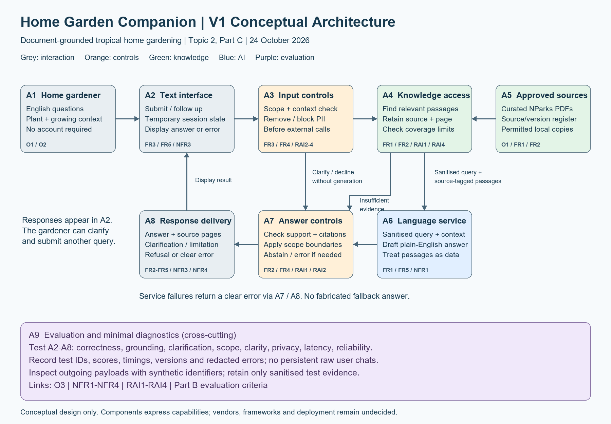
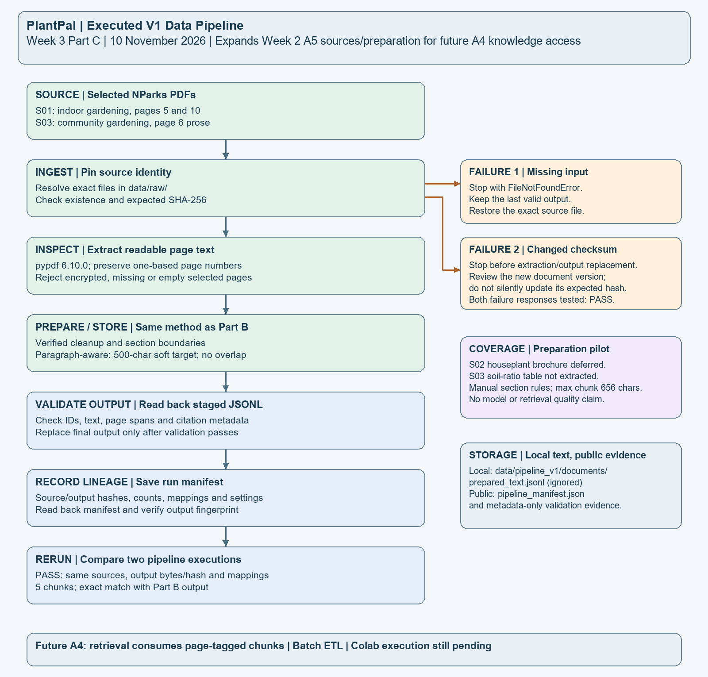

# Home Garden Companion: An AI Assistant for Tropical Gardening — Project Proposal

RAQIB HAZIM BIN ABDUL HAMID | A24AI0118 | SECTION 3

**Year / Course:** 3 / SAIAH · **Semester:** 1 · **Section:** 3

**Lecturer:** DR HAZLIFAH BINTI MOHD RUSLI
22 November 2026

## 1 Problem Definition and Project Scope

### 1.1 Background and Problem Statement

Home Garden Companion is proposed for beginner gardeners who need to relate general plant-care information to the conditions in their own indoor or balcony spaces. A question about watering may depend on plant identity, light, growing medium and the available evidence. A useful assistant therefore needs to identify when information is missing, retrieve relevant guidance and show the source rather than present a confident but unsupported instruction.

NParks explains that plants should fit their growing environment and identifies light, water, space and soil as important considerations [1]. Its indoor gardening guide presents space, light, water and plant choice together on PDF page 5 [2]. These sources support the practical importance of context-sensitive gardening information. They do not establish how many users want a chatbot, how often beginners fail to find information, or whether Home Garden Companion would improve plant survival. No survey, interview or user-outcome evidence has been collected.

The proposed engineering problem is to connect a beginner’s natural-language question with a concise explanation that remains traceable to reviewed gardening documents. Users can already read official guides or search them directly. Home Garden Companion must justify its additional complexity through evaluation against keyword search over the same approved collection. An explanation that sounds helpful but cannot be verified would not satisfy the project.

AI is appropriate to investigate because questions can be phrased in different ways and may require combining passages. However, language generation is not itself evidence. The design separates access to documents from answer generation and includes clarification, abstention and scope controls. The intended benefit is easier access to supported guidance, not automatic diagnosis or a guarantee of gardening outcomes.

The project is at proposal stage. Requirements and a conceptual architecture are documented; a small pipeline has been executed and audited. The application, retrieval configuration and participant study remain future work. These boundaries are retained throughout this report to distinguish evidence from expected behaviour.

### 1.2 Related Work and Engineering Gap

Official NParks guides and its plant-selection resources provide an existing information route [1–4]. Their strength is direct access to published horticultural guidance. A reader must still find relevant sections and relate them to a question. Our inspection also found that visual layouts can carry information that plain PDF extraction loses. This is a preparation limitation of our method, not proof that the source documents are poor.

Lewis et al. introduced retrieval-augmented generation that combines a parametric language model with retrieved external memory [5]. The research motivates considering external evidence alongside generation. Home Garden Companion does not reproduce the paper’s training method or benchmarks. Its practical use of retrieved gardening passages must be evaluated independently, especially when the available collection is small or incomplete.

Gao et al. introduced ALCE to evaluate generated answers with citations, including correctness and citation quality [6]. This informs the decision to score whether a reference exists separately from whether its passage supports the associated claim. Home Garden Companion will use manual claim-level checks appropriate to its limited prototype. A citation-looking string or a valid PDF page number alone will not count as supported evidence.

Liu et al. found that performance on their long-context tasks can depend on where relevant information appears [7]. This motivates testing selective context rather than assuming that placing all documents into a prompt is sufficient. It is not evidence that a particular chunk length or retriever is optimal for gardening. Those choices remain engineering hypotheses.

The gap is a bounded, testable integration of context handling, reviewed source access, page-level citations and explicit limits for beginner tropical home gardening. The proposed contribution is engineering integration and evaluation, not a claim of a new learning algorithm or the absence of competing products. A keyword-search baseline will reveal whether the conversational layer improves supported task completion enough to justify its cost and failure modes.

### 1.3 Objectives Target Users and Scope

O1 is to identify beginner information needs and establish a verified source collection covering light, watering principles, growing media and space. Needs findings, source coverage and scope boundaries should lead to testable requirements. Source inspection has progressed, but user-needs validation and a complete approved collection are not yet achieved.

O2 is to develop a text-based retrieval-augmented assistant that retrieves relevant guidance, explains it in plain language and supplies verifiable document/page citations. It should ask for essential missing context, refuse excluded requests and acknowledge insufficient evidence. The conceptual design specifies these behaviours; the pipeline is only a precursor to the application.

O3 is to evaluate correctness, citation support, clarity, response time and handling of unsupported or out-of-scope questions. A later task study will compare success and time to a correct, source-supported answer with keyword search over the same corpus. No superiority over search is assumed.

Intended users are beginner tropical home gardeners working with indoor or balcony plants. V1 assumes English text input, a single-user prototype workload and access to a deliberately bounded document collection. Examples include explaining light requirements or comparing supported plants when source coverage is sufficient. The system should request plant identity or growing conditions when those details are essential.

The scope excludes image-based identification or diagnosis, pesticide dosages and mixing, ingestion advice, safety guarantees, automated watering and live environmental sensing. It does not require user accounts, persistent personal memory or exact household addresses. The presence of a species name in a passage does not make all advice about that species supported.

The current five-chunk pilot cannot yet support the full proposed scope. In particular, plant-profile comparisons and the omitted soil-ratio table are not available. The proposed scope must be supported by authorised additional evidence or explicitly narrowed before downstream evaluation. Quietly treating missing tasks as implemented would undermine both requirements and test validity.

## 2 Requirements Specification

### 2.1 Functional Requirements and Responsible AI

The functional requirements specify observable behaviour rather than a particular vendor or framework. Each requirement includes a boundary so that the application cannot satisfy the positive behaviour by inventing unsupported detail. The following is a summary of the versioned Week 2 specification [9].

Clarification addresses ambiguity before tailored guidance. Abstention addresses a lack of evidence even when the question is clear. Refusal addresses an excluded task. These outcomes should remain distinct in the interface and evaluation. A normal response can legitimately be a clarification or abstention, but an abstention to a question labelled answerable still fails the answer-correctness test.

| ID | Required behaviour | Boundary |
| --- | --- | --- |
| FR1 | Answer supported light, water, media, space and plant-comparison questions. | Do not invent care facts or fixed watering schedules. |
| FR2 | Attach title, URL and one-based PDF page to factual claims. | Do not fabricate sources or imply unsupported claims are sourced. |
| FR3 | Ask for essential missing plant/growing context. | Do not silently assume decisive conditions. |
| FR4 | Acknowledge missing evidence and refuse excluded tasks. | Do not supply excluded actionable instructions or guarantees. |
| FR5 | Explain guidance in plain language. | Do not hide uncertainty behind unexplained jargon. |

### 2.2 Quality Requirements and Objective Alignment

NFR1 requires responsive interaction; NFR2 requires correct supported answers; NFR3 requires reliable normal operation and controlled failure handling; NFR4 requires clear, understandable explanations. O1 is supported by source and scope verification, O2 by FR1–FR5 and the response controls, and O3 by measuring NFR1–NFR4 and RAI1–RAI4. Section 3 specifies the measurement methods and acceptance targets. These requirements apply to the proposed application, not to the already executed extraction pipeline.

Responsible AI requirements complement these behaviours. RAI1 covers citation completeness, claim support and appropriate abstention. RAI2 requires safe handling of excluded requests. RAI3 minimises personal data before external transmission and in logs. RAI4 requires useful clarification and disclosure of species or climate limits. None of these controls is guaranteed merely by including a guardrail component in the architecture.

| Objective | Requirement alignment | Evidence or planned check |
| --- | --- | --- |
| O1 Needs and sources | FR1 scope; FR2 provenance; RAI4 coverage | Source inventory and audit exist; user-needs validation remains planned. |
| O2 Cited text assistant | FR1–FR5; RAI1–RAI4; NFR1 and NFR3 | A2–A8 implement the proposed interaction and controls; application not yet built. |
| O3 Evaluate usefulness | NFR1–NFR4; RAI1–RAI4 | A9 runs the Section 3 evaluation; comparison with keyword search is planned. |

## 3 Evaluation Criteria

### 3.1 Metrics and Acceptance Criteria

All thresholds are proposed prototype acceptance targets inherited from Week 2 [10], not achieved results or statistically established user expectations. They make trade-offs reviewable before testing. Correctness and source support are separate because a fluent response can be incorrect and a real citation can fail to support a claim. Safety/privacy conditions must not be averaged away by a good overall score.

The initial 85% correctness and 90% clarity targets are engineering goals for a bounded prototype. Their practical adequacy needs user validation and later error analysis. The 100% citation-completeness target reflects the requirement that factual claims be traceable. Latency targets aim at a usable single-user interaction but have not been validated through user timing studies. Threshold changes must be versioned and justified before final interpretation.

| Measure | Method and denominator | Proposed acceptance |
| --- | --- | --- |
| Correctness / NFR2 | 40 answerable cases, reference facts and pages | At least 34/40; report by topic |
| Citation / RAI1 | Claim-level completeness and passage support | 100% coverage; at least 95% support |
| Abstention / RAI1 | 20 unsupported cases | At least 19/20 |
| Clarity / NFR4 | 40 answers; direct, plain, readable rubric | At least 36/40 score 3/3 |
| Latency / NFR1 | 40 sequential cases, one excluded warm-up | Median ≤10 s and p95 ≤20 s |
| Reliability / NFR3 | 90 normal cases; 5 simulated failures | At least 89/90; 5/5 failures handled |
| Privacy / RAI3 | 20 synthetic-identifier scenarios; inspect payloads/logs | Zero external transmission, persistence or unnecessary requests |

### 3.2 Evaluation Protocol and Search Baseline

The planned normal workload contains 40 answerable questions, 10 ambiguous questions, 20 unsupported questions and 20 out-of-scope questions. The answerable set has ten cases each on light, watering, media and space/plant comparisons, including at least eight multi-passage questions. Ten coverage-disclosure cases reuse the unsupported set rather than add another ten. Privacy scenarios and controlled service failures are separate [10].

Reference facts and source pages must be established before a case is called answerable. The current pilot lacks sufficient coverage to instantiate the complete test set. Development examples should be kept separate from the final cases, and corpus/model versions, run dates and reviewer notes must be retained. Repeated use of the same answers for correctness, citation and clarity scoring avoids unnecessary generation without merging the measures.

A missing answer, error or abstention to an answerable question fails correctness. Each independently checkable factual assertion is a claim; a shared citation can support several claims only if it supports each one. A response with no factual claims has no meaningful citation denominator and cannot earn 100% grounding by saying nothing. Latency includes retrieval, generation and retries; unsuccessful requests are reported separately rather than counted as fast successes.

Additional targets include at least 9/10 appropriate clarifications, 10/10 designated coverage-limit disclosures and at least 19/20 full refusal-and-redirect successes with zero excluded actionable instructions or safety guarantees. The nearest-rank p95 for 40 successful responses is the 38th sorted duration. These decisions make both denominators and failure treatment explicit.

The planned comparison uses keyword search over the same approved documents. Users should answer matched questions and identify supporting evidence under both conditions, with order varied to reduce learning effects. Record supported task completion and time to a correct supported answer, distinguishing user task time from model latency. Participant count, recruitment, consent and task allocation remain to be specified before any study; no participant outcomes are claimed.

## 4 AI System Architecture

### 4.1 Components and Information Flow

The architecture separates source preparation, knowledge access and answer generation. A1 supplies a question through A2. A3 checks scope, missing context and personal identifiers before external-bound processing. A4 retrieves candidate evidence from A5 and retains source/page information. A6 drafts the explanation, A7 checks support and boundaries, and A8 returns the selected answer or limitation. A9 evaluates the interaction and keeps minimal diagnostics [11].

The diagram is conceptual: boxes represent responsibilities, not separate deployed services. The system does not yet implement retrieval, a language model or semantic output checking. The executed Week 3 pipeline develops the source-preparation responsibility in A5, preparing records for future A4. It does not demonstrate the complete interaction path.

Alternative paths matter as much as the normal answer. Essential missing context leads to clarification. Insufficient evidence leads to abstention. Excluded requests lead to refusal. Dependency failures should return clear errors rather than invented answers. Exact methods for identifier detection and semantic claim checking will require experiments and failure analysis.

Figure 1. Home Garden Companion conceptual architecture, created for Week 2 [11]. Application components remain proposed.

### 4.2 Design Decisions and Trade Offs

External knowledge access is selected because source grounding is central to FR1/FR2. A base model alone cannot demonstrate which approved page supports a claim. Retrieval adds indexing, relevance errors and latency; the keyword-search baseline remains available to test whether generation is worthwhile. Model/API and retrieval technology selection are intentionally not presented as settled implementation facts.

Page-level provenance is preserved from ingestion through chunks and responses. This is preferable to asking a model to invent references from memory. The cost is more metadata and validation logic. A valid document/page identifier still cannot establish semantic support, so reference validation and claim-support review remain distinct. The citation research informs this separation [6].

Input controls and output controls have different roles. A3 can prevent some out-of-scope or privacy-sensitive material from reaching downstream services, while A7 can identify inappropriate or unsupported drafted answers. Neither guarantees detection. A local check that misses an identifier and a semantic check that accepts an unsupported statement are failure cases to test, not reasons to assume safety by architecture.

V1 proposes transient conversation context, no account requirement and no persistent personal profile. This reduces stored personal information and implementation scope but limits personalisation and debugging. Diagnostics should contain case IDs and error categories, not unredacted user messages. Synthetic privacy tests need outgoing-payload and log inspection rather than judging only the visible response.

The normal path aims for one generation step with selected context, subject to later feasibility testing. This bounds complexity and supports latency measurement but gives less opportunity for iterative repair. Research about long-context position effects motivates testing context selection, not a promise that small context always performs better [7]. User-facing benefits remain hypotheses until evaluated.

The implementation should begin with the simplest local arrangement that satisfies these responsibilities. A dedicated vector database, autonomous agent loop, live weather connection and image model are not required by this proposal. Technologies can change while the requirements, evidence links and accepted trade-offs remain explicit.

## 5 Data Engineering and Quality

### 5.1 Sources Preparation and Lineage

Three public NParks PDFs were inspected locally: S01 Introduction to Indoor Gardening (24 pages), S02 Know 10 Houseplants (2 pages), and S03 Introduction to Community Gardening (20 pages) [2–4, 12]. These 46 pages are an inspected collection, not an approved complete answer corpus. Only S01 pages 5/10 and S03 page 6 prose entered the five-chunk pilot.

The notebook identifies exact filenames and expected SHA-256 values, checks readable PDFs and extracts page text with pypdf 6.10.0. Originals remain unchanged. Source identity, title, URL and one-based page accompany prepared records. Hashes identify the inspected snapshot; they do not prove factual accuracy, permission or publication currency.

Inspection found an image-only page in S01, hidden editorial text on another page, mixed profile reading order in S02 and missing structured/icon information in S03. The image-only page was not called corrupt merely because text extraction was empty. Verified cleanup removed the hidden placeholder, repaired known section boundaries and retained source wording. S02 was deferred rather than assigning plant-care text to potentially wrong headings.

Fixed 500-character and paragraph-aware chunking were compared on identical selected text. Both yielded five chunks. Fixed cuts split two verified sections and one word; paragraph-aware packing split neither. Its largest chunk was 656 characters, so 500 is a soft target rather than a hard maximum or token limit. The choice preserves meaning at the cost of variable length and manual, source-specific rules.

Batch ETL was chosen for static reviewed inputs: extract text, transform selected sections and load JSONL. Raw snapshots support review; a streaming service is not justified. Source-derived files remain local and ignored by Git. Public artifacts contain source metadata, original observations and limited evidence, not redistributed full PDF text.

### 5.2 Pipeline Execution and Verification

The V1 runner re-reads source files independently of Part B’s in-memory extracted text. It checks identity, inspects selected pages, prepares records, writes a staged JSONL and validates the read-back before replacing the previous output. The execution manifest records configuration, hashes, sizes, counts and source-to-output mappings [13].

Two runs produced identical source/output fingerprints, sizes, record counts and mappings. Their five records matched Part B byte for byte. Missing-file and altered-checksum tests stopped before replacing valid output. These are local repeatability and failure-response checks, not proof of cross-environment reproducibility or model-answer quality. Colab-compatible code exists, but no connected Colab execution is claimed.

The workflow expands the data component of Week 2 rather than replacing the overall architecture. A future downstream system must respect the current HOLD decision and resolve source-use and coverage issues before promoting these records into the intended answer corpus.

Figure 2. Home Garden Companion preparation pipeline, created and executed for Week 3 [12, 13]. This pipeline prepares data for A5.

### 5.3 Quality Findings Risks and Mitigations

The Week 4 audit inspected every prepared chunk, using a chunk as its unit. All five had complete citation fields and consistent metadata. Selected prose matched the source pages after documented changes. No duplicate IDs or whitespace-normalised exact duplicate texts were found. Timeliness remained Not Verified because publication/revision status and a task-based freshness criterion were not established [14].

V1 checked source references against the register, actual PDFs and manifest; V2 checked source fidelity and intact heading/body associations through documented manual comparison. Both passed 5/5. The short 166-character section and long 656-character section were valid exceptions rather than defects. A pass on selected-prose fidelity does not imply that every source-page element was extracted.

Coverage remained limited. One chunk covered general light, water and space principles; none supplied complete plant profiles supporting care comparisons. The soil-ratio table was missing. Selecting easy-to-extract prose while deferring complex layouts can skew future retrieval toward generic advice. This is a plausible pipeline-induced/representation risk, not demonstrated unfairness or measured model behaviour.

Manual review found no personal identifiers or private user conversations in these five prose records. The finding does not extend to all raw assets or future user inputs. The source-use review found no recorded authorisation for the intended downstream AI processing/service or redistribution. NParks terms were reviewed; public availability was not treated as an open licence [8].

The gate is HOLD for promotion of this pilot to the intended answer corpus/public AI service. The reasons are unresolved intended-use permission, incomplete comparisons and structured content, and unverified currency. This does not invalidate the pipeline or audit as coursework evidence. It means preparation success is insufficient to justify the proposed downstream use.

The student maintainer must first resolve rights or select appropriately licensed replacements, then verify task coverage, source versions and new manifests. Re-review requires documented access grounds, reviewed evidence for claimed tasks and rerun validation. Source changes, changed requirements or newly reported errors also trigger revalidation.

## 6 Implementation Plan and Conclusion

### 6.1 Implementation Stages and Expected Contribution

The next phase is conditional on resolving the data gate. First, confirm intended-use rights and source versions or replace sources with appropriately licensed material. The project owner should also validate beginner information needs and agree the supported task list. This prevents implementation from optimising an assumed need or relying on evidence that cannot be used for the intended purpose.

Second, repair coverage through reviewed plant-profile associations and structured information, or explicitly agree a narrower project scope. Record each supported task with its source evidence. Re-run reference and fidelity checks, update manifests and make a new scoped gate decision. A larger document count alone is not a readiness measure; the added content must support the promised tasks.

Third, implement the smallest text interaction with local knowledge access, transient context, cited drafting and explicit failure outcomes. Select retrieval and model configurations using development cases. Keep the keyword-search interface comparable by giving it the same approved corpus. Do not use the final evaluation cases to repeatedly tune the system without documenting the resulting limitation.

Fourth, prepare the reference sets and run the planned evaluation. Report denominators, per-topic correctness, claim support, clarity, latency, privacy and failure handling. Investigate each failed case, version any improvement and preserve the original evidence. Conduct the exploratory user comparison only after the study procedure and participant consent arrangements are established.

The expected contribution is a traceable specification, justified architecture, repeatable preparation workflow and evaluated prototype. Planning, pipeline and audit evidence are available; model accuracy, user benefit and plant-health improvement are not yet established.

### 6.2 Conclusion

Home Garden Companion will be evaluated as a bounded, evidence-based alternative to keyword search. The preparation pilot identifies the permission and coverage gaps that must be resolved before application testing. Subsequent work will retain traceability from requirements to source evidence and measured outcomes.

## References

[1] National Parks Board. Choosing Plants. GardeningSG, 17 July 2023. https://gardeningsg.nparks.gov.sg/gardening-resource-library/choosing-plants/ (accessed 22 November 2026).

[2] National Parks Board. Introduction to Indoor Gardening. PDF, pp. 5 and 10. https://isomer-user-content.by.gov.sg/316/5be81ffb-fd47-444d-ab81-bf46b869dd7b/introduction_to_indoor_gardening.pdf (accessed 10 November 2026; publication date not verified).

[3] National Parks Board. Introduction to Community Gardening. PDF, p. 6. https://isomer-user-content.by.gov.sg/316/e9f8a03b-d2aa-4f29-b16a-0678ea9ca5a9/introduction%20to%20community%20gardening.pdf (accessed 10 November 2026; publication date not verified).

[4] National Parks Board. Know 10 Houseplants; Downloadable resources. https://gardeningsg.nparks.gov.sg/learn-more-about-gardening/downloads/ . Brochure inspected locally; excluded from pilot preparation.

[5] Lewis, P., et al. (2020). Retrieval-Augmented Generation for Knowledge-Intensive NLP Tasks. NeurIPS 33. https://arxiv.org/abs/2005.11401

[6] Gao, T., Yen, H., Yu, J., & Chen, D. (2023). Enabling Large Language Models to Generate Text with Citations. EMNLP, 6465–6488. https://aclanthology.org/2023.emnlp-main.398/

[7] Liu, N. F., et al. (2024). Lost in the Middle: How Language Models Use Long Contexts. TACL 12, 157–173. https://aclanthology.org/2024.tacl-1.9/

[8] National Parks Board. Terms of Use. Page states 26 June 2026 update. https://gardeningsg.nparks.gov.sg/terms-of-use/ (reviewed 22 November 2026).

## Project evidence references

[9] Home Garden Companion project repository. Week 2 requirements, version 1.1, 26 October 2026. docs/week2_requirements.md.

[10] Home Garden Companion project repository. Week 2 evaluation criteria. docs/week2_evaluation_criteria.md.

[11] Home Garden Companion project repository. Week 2 architecture decisions and traceability. docs/week2_architecture_decisions.md.

[12] Home Garden Companion project repository. Week 3 data inventory and pipeline decisions. docs/week3_data_inventory.md; docs/week3_pipeline_decisions.md.

[13] Home Garden Companion project repository. Executed notebook and Part C validation. notebooks/week3_pipeline.ipynb; data/inspection/week3_part_c_validation.json; data/pipeline_v1/documents/pipeline_manifest.json.

[14] Home Garden Companion project repository. Week 4 Data Quality & Bias Report, 22 November 2026. docs/week4_data_quality_report.md; data/inspection/week4_part_b_validation.json.

Repository for [9]–[14]: https://github.com/Pokeepic/ai-engineering-plantpal . These are author-created project artifacts and execution evidence, not independent research studies.
