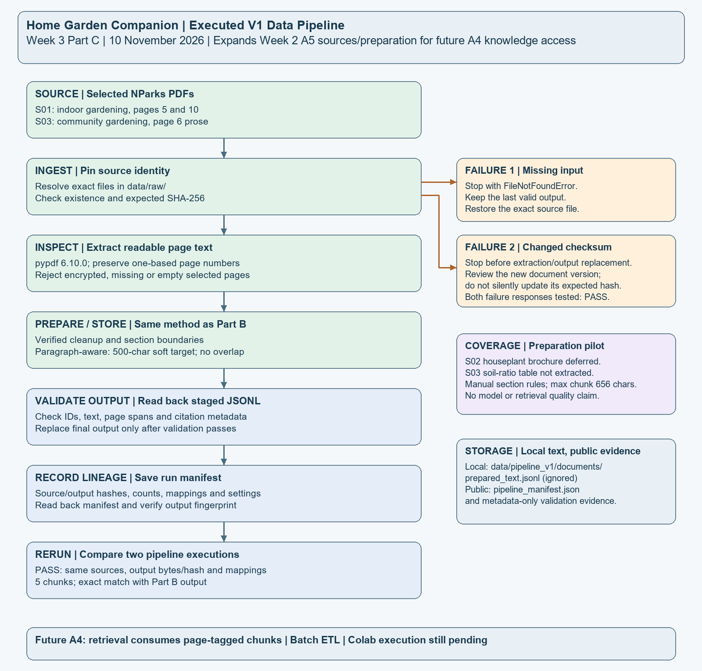

# Home Garden Companion - Week 3 V1 Data Pipeline Decisions

**Date:** 10 November 2026. **Status:** Parts A-C executed locally in Python 3.12.14 with pypdf 6.10.0. Colab execution remains pending. This is a selected-prose preparation pilot, not the full Home Garden Companion answer corpus.

[Notebook](../notebooks/week3_pipeline.ipynb) | [Diagram](week3_pipeline_diagram.png) | [Editable Draw.io diagram](week3_pipeline_diagram.drawio) | [Source inventory](week3_data_inventory.md)

## Relationship to the Topic 2 Architecture

The pipeline expands **A5 Approved sources and register**, preparing document/page-tagged records for future **A4 Knowledge access**. It does not implement the interface, retrieval, language model or answer controls. Topic 2 acceptance targets remain unmeasured; pipeline checks do not establish answer quality.

The PNG and editable Draw.io XML were generated from the same diagram layout and visually checked. The Draw.io desktop editor was not used for export; the source can be opened and edited in diagrams.net.

## Requirements and Source Selection

| Requirement | Data need | Implemented support | Remaining limitation |
|---|---|---|---|
| FR1 | Documented light, water, media and space guidance | Selected indoor-gardening sections and general soil prose | Small pilot; no complete species coverage or answer evaluation |
| FR2 | Traceable title, URL and one-based PDF page citations | Each chunk retains source ID, filename, title, URL, hash, page and cleaned-text span | Valid citation metadata does not prove that a generated claim is supported |
| RAI1 | Source support and acknowledgement of missing evidence | Pin source bytes; omit ambiguous profiles and missing table/icon information; document exclusions | Manual admission can miss errors; claim-support and abstention tests remain later work |

| Source | Selected content | Admission / exclusion |
|---|---|---|
| S01 - [Introduction to Indoor Gardening](https://isomer-user-content.by.gov.sg/316/5be81ffb-fd47-444d-ab81-bf46b869dd7b/introduction_to_indoor_gardening.pdf) | PDF pages 5 and 10 | Keep verified prose; remove the confirmed hidden editorial placeholder from page 10; reconstruct section boundaries from checked headings |
| S03 - [Introduction to Community Gardening](https://isomer-user-content.by.gov.sg/316/e9f8a03b-d2aa-4f29-b16a-0678ea9ca5a9/introduction%20to%20community%20gardening.pdf) | PDF page 6, extracted prose only | Retain definitions/general soil guidance; move the extracted trailing heading to the beginning; do not reconstruct the missing soil-ratio table |
| S02 - Know 10 Houseplants | None in this pilot | Mixed heading/profile extraction requires further verification; remains inspected but deferred |

Other pages are not selected, rather than presumed invalid. Source hashes and URLs are recorded in the manifests. PDF metadata dates are not treated as verified publication dates. Original PDFs are never modified.

## Part B Evidence and Selected Configuration

[Measured comparison](../data/inspection/week3_part_b_comparison.json), using identical cleaned text from three pages:

| Method | Chunks | Cuts inside verified sections | Cuts inside words | Maximum characters | Chunks above target |
|---|---:|---:|---:|---:|---:|
| Fixed 500-character cuts | 5 | 2 | 1 | 500 | 0 |
| Paragraph-aware packing | 5 | 0 | 0 | 656 | 1 |

Local sample inspection found fixed cuts separated plant-choice advice and split a word in the media section. Paragraph-aware packing retains those sections. The selected settings are **paragraph-aware, target 500 characters, zero overlap, page-local**, with manually verified section boundaries. An oversized section remains intact: 500 is a soft character target, not a token limit. The method is not semantic chunking.

Accepted limitations: variable lengths, source-specific rules, no cross-page context, incomplete table/icon extraction and limited source coverage. Neither method has yet been evaluated for retrieval relevance or generated-answer correctness.

## Engineering Decisions

| Decision | Selected option and rationale | Alternative / accepted trade-off |
|---|---|---|
| ETL or ELT | ETL into prepared JSONL: extract page text, transform selected sections, then load the prepared dataset | Keeping raw working copies supports inspection but is not an analytical ELT warehouse; no database is needed yet |
| Batch or streaming | Batch on demand when reviewed sources/settings change; the two PDFs are static inputs | Streaming would add complexity without a live event source; updates require review and rerun |
| Execution | Reusable functions in the existing notebook; pipeline re-reads PDFs on every invocation | No dependency on Part B's in-memory text or prepared records; common setup/source register still required |
| Source identity | Reject unexpected SHA-256 values before preparation | Intentional source updates require review and a new expected hash; hashes do not establish permission or truth |
| Store and validate | Write a staged JSONL, read back/check it, then replace the final output | Preserves the last valid prepared file if extraction or record validation fails; not a transactional database |
| Lineage | Separate Part B preparation manifest and Part C execution manifest | Shared output has an explicit mapping from each contributing source; timestamps change between runs |
| Sharing | Publish code, diagram, decisions and metadata-only evidence; keep source text local | Fresh clones must run the notebook to recreate local data; no open redistribution licence has been established |

## Stage Contracts and Failure Responses

| Stage | Contract / actual evidence | Failure response |
|---|---|---|
| Ingest | Exact selected files exist under `data/raw/`; SHA-256 matches the inspected source register; use remains limited to the documented local working-copy context | Missing file or changed checksum stops before output replacement; access review remains a human responsibility |
| Inspect | Parser version matches; input readable and not encrypted; selected page numbers valid and selected text non-empty | Reject unreadable/empty input; review source rather than inventing content |
| Prepare | Verified heading rules match; paragraph packing retains all non-whitespace selected text; original pages remain associated | Stop on unexpected headings, unsupported settings or content-loss check failure |
| Validate | JSONL read-back equals expected records; unique IDs, non-empty text, valid selected page spans, title and URL present | Reject staging output; retain last valid prepared file |
| Record lineage | Source IDs/pages map to exact output; run settings, source hashes, output hash/size/count and caveats saved and read back | Raise an error for manifest mismatch; do not report a successful run |
| Repeat | Second run matches source fingerprints, output hash/size/count, mappings and configuration | Fail the smoke check and investigate the difference; exclude timestamps from comparison |

## Executed Results

- Two source files, three selected pages, **five prepared records** in one JSONL output.
- Part C's prepared JSONL matches Part B **byte for byte**.
- Two full pipeline executions passed the repeatability check.
- Missing-input test: `FileNotFoundError`; last valid output unchanged.
- Changed-checksum test: `ValueError`; last valid output unchanged.
- These failure tests alter copies of the source register, not the original PDF files.
- Full sample inspection was performed locally in Part B. Byte equality establishes that Part C contains the same reviewed samples.

See [Part C validation evidence](../data/inspection/week3_part_c_validation.json) and [execution manifest](../data/pipeline_v1/documents/pipeline_manifest.json). These results demonstrate local stage contracts and repeatability, not cross-environment reproducibility, factual accuracy, complete rights clearance or Responsible AI acceptance.

## Storage and Rerun Instructions

| Location | Contents | Repository treatment |
|---|---|---|
| `data/raw/` | Original personal working-copy PDFs | Ignored; local only |
| `data/processed/` | Part B prepared JSONL and candidate chunk files | Ignored; local only |
| `data/week3_manifest.json` | Part B preparation lineage | Committed metadata |
| `data/pipeline_v1/documents/prepared_text.jsonl` | Part C pipeline output | Ignored; local only |
| `data/pipeline_v1/documents/pipeline_manifest.json` | Part C execution provenance and checks | Committed metadata |
| `data/inspection/week3_part_c_validation.json` | Repeatability and failure-response evidence | Committed metadata |

Open the repository folder in VS Code, select a Python kernel and run all cells of `notebooks/week3_pipeline.ipynb`. Missing personal working copies are obtained from the explicit source URLs; expected hashes must match. The notebook also supports Colab paths, but no Colab execution is claimed. Colab `/content` storage is temporary: preserve permitted local outputs before the session ends.

Access review is recorded in the inventory, referencing the [NParks download directory](https://gardeningsg.nparks.gov.sg/learn-more-about-gardening/downloads/) and [terms](https://gardeningsg.nparks.gov.sg/terms-of-use/), reviewed 10 November 2026. Public availability is not an open redistribution licence. The code does not make a legal authorisation determination. Reassess access before expanding use or sharing source text.

## Lab Traceability

Topic 3 Lab: C1 / Cells 7, 8A and 9 implemented in the notebook; C2 diagram and editable source supplied; C3 requirements, configuration, stage contracts and decisions recorded here; C4 shareable artifacts committed to the existing repository, with local-only content documented above. Topic 4 quality assessment, Colab runtime evidence and any course-portal submission remain separate work.
